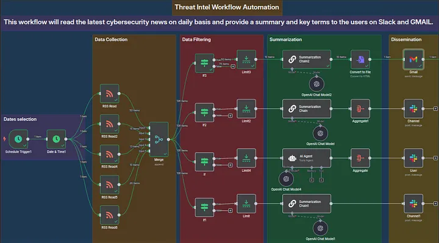
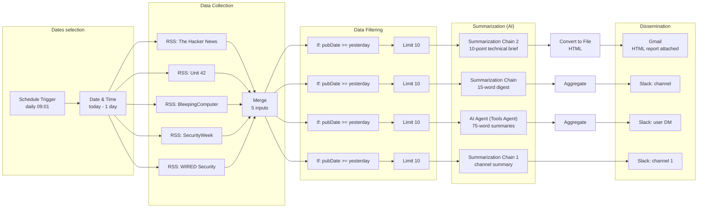

# AI cyber news briefing: n8n threat intel automation

> A daily, fully automated cyber threat news pipeline. **n8n** reads five security news feeds, keeps only the last 24 hours, has **OpenAI-powered AI agents** turn the articles into analyst-ready briefs (summary, CVEs, MITRE ATT&CK TTPs, IOCs), and delivers them to **Slack** and **Gmail** at 09:01 every morning.


---

## Blog posts

I wrote about this n8n automation work in more detail here:

- [How I Automated My Threat Intelligence Workflow with n8n (and What It Taught Me)](https://medium.com/meetcyber/how-i-automated-my-threat-intelligence-workflow-with-n8n-and-what-it-taught-me-f8c14aba6c72) on Medium (MeetCyber)
- [From Headlines to Slack: Automating Cyber Threat Intelligence Delivery](https://bloo.io/blog/from-headlines-to-slack-automating-cyber-threat-intelligence-delivery) on the Bloo blog (June 2025)

## Why I built this

Every morning a threat intelligence analyst has to read dozens of articles across many outlets just to answer one question: *what changed in the threat landscape since yesterday, and does it matter to us?* This **proof of concept** automates the **Collection → Processing → Analysis → Dissemination** steps of the intelligence cycle:

- **Collection:** five reputable security news and research feeds.
- **Processing:** only stories published since yesterday, capped per lane to control LLM cost.
- **Analysis:** AI agents write briefs in fixed formats for different readers, from a one-line headline digest to a 10-point technical brief with CVEs, ATT&CK TTPs and IOCs.
- **Dissemination:** a Slack channel post, a Slack direct message and an HTML email report.

## Workflow canvas



The canvas is laid out as the intelligence cycle, left to right: **Dates selection → Data Collection → Data Filtering → Summarization → Dissemination**. Each of the four horizontal lanes is its own product for a different reader.

## Architecture



---

## How each stage and node works

### 1. Dates selection

| Node | n8n type | What it does |
|---|---|---|
| **Schedule Trigger1** | `scheduleTrigger` | Starts the run every day at **09:01**. Its output includes `timestamp` and a `Readable date`, which later nodes use in message headers and file names. |
| **Date & Time1** | `dateTime` (Subtract From Date) | Subtracts **1 day** from the trigger timestamp and stores it as `Yesterday_Date`. This is the freshness cut-off for every lane. |

### 2. Data Collection

| Node | Source | Why this source |
|---|---|---|
| **RSS Read** | The Hacker News: `feeds.feedburner.com/TheHackersNews` | High-volume breaking news on vulnerabilities and campaigns |
| **RSS Read2** | Palo Alto Networks Unit 42: `feeds.feedburner.com/Unit42` | Vendor threat research (actors, malware, TTPs) |
| **RSS Read4** | BleepingComputer: `bleepingcomputer.com/feed/` | Ransomware, data breaches, exploitation news |
| **RSS Read5** | SecurityWeek: `securityweek.com/feed/` | Enterprise security, ICS and vulnerability news |
| **RSS Read6** | WIRED Security: `wired.com/feed/category/security/latest/rss` | Strategic and policy context |
| **Merge** | `merge` (5 inputs, append) | Combines all feed items into one stream (about 100 items per run in the screenshot) |

### 3. Data Filtering

Each lane has the same two-step filter, so each AI lane gets a clean, bounded input:

| Node | n8n type | What it does |
|---|---|---|
| **If / If1 / If2 / If3** | `if` (dateTime `afterOrEquals`) | Keeps only articles where `pubDate >= Yesterday_Date`. Older items go to the false branch and are dropped. |
| **Limit / Limit2 / Limit3 / Limit4** | `limit` (max 10) | Caps each lane at **10 articles**. This bounds token spend and keeps the briefing readable. |

### 4. Summarization (the AI layer)

Each lane pairs an **LLM node** with an **OpenAI Chat Model** sub-node. The two are joined by n8n's dedicated `ai_languageModel` connection (the diamond "Model" port on the node).

| Lane | AI node (as on canvas) | Model | Agentic task |
|---|---|---|---|
| 1 | **Summarization Chain2** | OpenAI Chat Model2 | Per article: a **10-point technical brief** with Title, Summary, **CVE IDs**, **MITRE ATT&CK TTPs** (tactics, techniques, procedures), **IOCs** (network, host, file, behavioural) and References. Duplicate stories are collapsed. |
| 2 | **Summarization Chain** | OpenAI Chat Model | A **15-word executive digest** of the day's articles, for a busy channel |
| 3 | **AI Agent** (Tools Agent) | OpenAI Chat Model4 | A **75-word summary** of each article, formatted as *Title*, summary and link, for a direct message to an analyst |
| 4 | **Summarization Chain1** | OpenAI Chat Model1 | A second channel summary for another team or channel |

| Node | n8n type | What it does |
|---|---|---|
| **Convert to File** | `convertToFile` (HTML) | Renders lane 1's briefs into `Cybersecurity News Summary (<date>).html` |
| **Aggregate / Aggregate1** | `aggregate` on `output` | Gathers the per-article LLM outputs into one list, so Slack gets **one message** instead of ten |

### 5. Dissemination

| Node | n8n type | Audience | Message |
|---|---|---|---|
| **Gmail** | `gmail` (send) | Leadership or a TI distribution list | Subject *"Threat Research & Intelligence (TRI)"*, with the HTML brief attached |
| **Channel** | `slack` (post to channel) | SOC or security channel | `Cybersecurity News for <date>` plus one bullet per item |
| **User** | `slack` (post to user) | An individual analyst (DM) | The same format, with the 75-word summaries |
| **Channel1** | `slack` (post to channel) | A second team channel | The lane 4 summary |

Slack messages include a link back to the n8n workflow (`includeLinkToWorkflow`), so readers can trace where a message came from.

---

## How the AI agents are built in n8n

n8n's AI nodes are built on **LangChain**. Each AI component in this workflow is assembled from two parts:

```text
 ┌──────────────────────────────┐        ai_languageModel        ┌─────────────────────────┐
 │  AI Agent / Summarization    │ ◄────────────────────────────── │  OpenAI Chat Model      │
 │  Chain (root node)           │                                 │  (sub-node: gpt-4o-mini)│
 │  • user prompt (promptType:  │                                 │  • credential: OpenAI   │
 │    define, n8n expressions)  │                                 └─────────────────────────┘
 │  • system message (format &  │
 │    guardrails)               │   (Tools Agent also exposes optional Memory and Tool ports)
 └──────────────────────────────┘
```

1. **Root node.** This is an `@n8n/n8n-nodes-langchain.agent` (Tools Agent) or a Summarization Chain. It holds the **prompt** with `promptType: define`, built from n8n expressions such as `{{ $json.title }}`, `{{ $json.content }}` and `{{ $json.link }}`, so each article is injected at run time.
2. **System message.** It sets the **output contract** (exact format, section order) and **guardrails**: don't echo the prompt, don't add knowledge-cutoff disclaimers, deduplicate repeated stories, and write "No specific CVE IDs found for this Issue" or "IOCs not found for the given issue" instead of inventing placeholders.
3. **Chat Model sub-node.** `lmChatOpenAi` set to `gpt-4o-mini`, a low-cost, fast model that suits high-volume summarisation. It plugs into the root node through the `ai_languageModel` port and authenticates with an n8n **OpenAI credential** (not stored in the JSON).
4. **Per-item execution.** n8n runs the agent **once for each article item**, then aggregates the results, which works like a map-reduce over the day's news.

<details>
<summary><b>Prompt design: lane 1 (10-point technical brief)</b>, click to expand</summary>

**User prompt**

```text
Summary: Read the article {{ $json.content }} and provide summary of the article in
10 bullet points covering the cybersecurity news, technical words and other important concepts.
```

**System message (abridged)**

```text
Write the output in the following format:
1. Title: {{ $json.title }}
2. Summary
3. CVE: quote any CVE ID in the article; otherwise try to identify the matching CVE.
   If none exists write "No specific CVE IDs found for this Issue" (no placeholder CVE-Year-XXXX).
4. TTPs: MITRE ATT&CK tactic / technique / procedure names and IDs for the attack.
5. IOCs: network-, host-, file- and behaviour-based indicators from the article.
   If not found, write "IOCs not found for the given issue".
6. References: {{ $json.link }}
Instructions: no knowledge-cutoff disclaimers, no sign-off lines,
and if a story is duplicated across feeds, consider it only once.
```
</details>

<details>
<summary><b>Prompt design: lane 2 (15-word digest) and lane 3 (75-word summaries)</b></summary>

- **Lane 2:** "Read all the articles … and provide summary of all the articles in 15 words." The system message lists real failure outputs seen during testing (for example *"I don't see the articles attached…"* and *"Summary (15 words):"*) and forbids them. This is **negative-example prompting** used to harden the output.
- **Lane 3:** "…provide summary … in one paragraph of 75 words". The system message fixes the format to `Title (italic) ‣ Summary ‣ link`.
</details>

---

## What a run produces

**Slack (lane 2 and lane 3)**

```text
Cybersecurity News for <date>
• <Title in italics> ‣ <75-word summary> ‣ https://…
• …
```

**Email (lane 1)**, with `Cybersecurity News Summary (<date>).html` attached:

```text
1. Title: <article title>
2. Summary: <10 bullet points>
3. CVE: CVE-2026-XXXXX | No specific CVE IDs found for this Issue
4. TTPs: Initial Access (TA0001) – Exploit Public-Facing Application (T1190) …
5. IOCs: <IPs / domains / hashes> | IOCs not found for the given issue
6. References: https://…
```

---

## Setup

1. **Import:** in n8n, go to *Workflows → Import from File* and choose `workflow/threat-intel-cyber-news-briefing.json`.
2. **Create credentials** (*Credentials → New*) and select them on the nodes:
   - **OpenAI API** on every *OpenAI Chat Model* node
   - **Slack API** (bot token with `chat:write`) on the Slack nodes
   - **Gmail OAuth2** on the Gmail node
3. **Replace placeholders:**

   | Placeholder | Where | Replace with |
   |---|---|---|
   | `REPLACE_WITH_YOUR_CREDENTIAL_ID` | all credential references | chosen automatically when you select a credential |
   | `YOUR_SLACK_CHANNEL_ID` | Slack channel node | your channel ID (e.g. `C0…`) |
   | `YOUR_SLACK_USER_ID` | Slack user node | the analyst's member ID (e.g. `U0…`) |
   | `recipient@example.com` | Gmail node | your distribution list |

4. Run it once with **Execute workflow**, then set the workflow to **Active** to enable the 09:01 schedule. Set the instance time zone under *Settings*.

## Related Blogs by Author

- https://medium.com/meetcyber/how-i-automated-my-threat-intelligence-workflow-with-n8n-and-what-it-taught-me-f8c14aba6c72
- https://bloo.io/blog/from-headlines-to-slack-automating-cyber-threat-intelligence-delivery

## Related projects

- [n8n-ai-threat-intel-daily-briefing](https://github.com/Shailendra7727/n8n-ai-threat-intel-daily-briefing): Daily Briefing and Content Update knowledge base on GitHub
- [n8n-ai-threat-intel-directory](https://github.com/Shailendra7727/n8n-ai-threat-intel-directory): an AI-built directory of attack campaigns, threat groups and malware

## License

[MIT](LICENSE). This is a proof of concept for portfolio and educational use.
